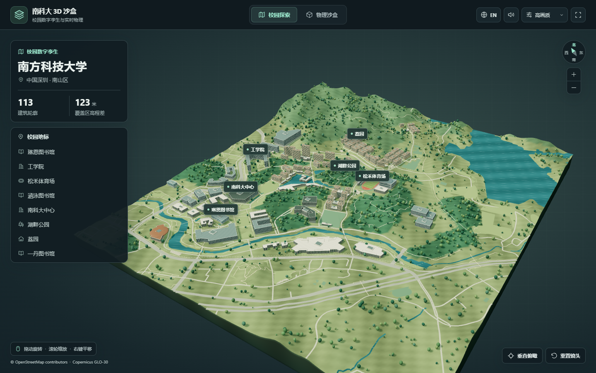
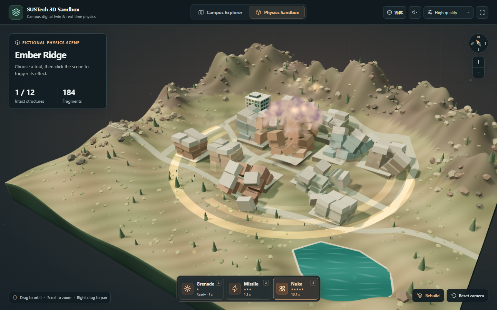

# SUSTech 3D Sandbox

[简体中文](README.zh-CN.md) · [GitHub Pages demo](https://bruce666-ppp.github.io/SUSTech-3D-Sandbox/) · [Data and licenses](DATA-SOURCES.md)

Explore Southern University of Science and Technology as an interactive mountain campus model, then switch to Ember Ridge, a fictional physics arena. Both experiences run entirely in the browser.



## What you can do

- **Campus Explorer.** Orbit the full campus, zoom in on façades or switch to a top-down view. Select a map pin or one of 14 landmarks to see its bilingual description and fly to it. The scene combines 113 OpenStreetMap building outlines with a Copernicus GLO-30 elevation surface. Roads, lakes, hillside vegetation and sports facilities give context to the academic and residential districts.
- **Physics Sandbox.** Choose Grenade, Missile or Nuke with the toolbar or keys `1`, `2`, `3`. Click the fictional scene to trigger the effect. Each tool has its own cooldown of 1, 5 or 15 seconds. Modular structures break into colliding rigid bodies with layered light, particles, audio and persistent rubble. Rebuild restores the arena and clears its transient simulation state while preserving live cooldown timers.
- **Display and accessibility.** Switch languages or quality while a scene is running. The interface remembers your language, sound and quality preferences. Touch gestures work alongside mouse controls.



| Input | Action |
| --- | --- |
| Left drag or one finger | Orbit |
| Mouse wheel or pinch | Zoom |
| Right drag or two-finger drag | Pan |
| Campus map pin or landmark list | Inspect a landmark |
| Sandbox tap or click | Use the selected tool |
| `1`, `2`, `3` | Select a sandbox tool |

## Run locally

Use Node.js 22.12 or newer and a WebGL 2 browser. The GitHub Actions workflow uses Node.js 24.

```sh
npm ci
npm run dev
```

For a production build and local preview, run the following commands.

```sh
npm run build
npm run preview
```

To run browser acceptance tests against the production files under `/SUSTech-3D-Sandbox/`, run the following commands. Set `SUSTECH_CHROME_PATH` to use an already installed Chrome binary. Set `SUSTECH_SOFTWARE_GL=1` for the Chromium SwiftShader test configuration.

```sh
npx playwright install chromium
npm run test:browser
```

## Architecture and deployment

Vite builds a static TypeScript app. Three.js shares a renderer and camera controller across two lazily loaded scenes. `src/campus.ts` builds the terrain, vector geometry, architecture and landmark metadata. `src/sandbox.ts` owns the Rapier world and its fixed-step simulation. `src/effects.ts` manages reusable particle and effect buffers, while `src/audio.ts` synthesizes sound with Web Audio. `src/i18n.ts` contains the interface dictionary and preference helpers. Exiting a scene releases its resources. The rendering presets set resolution, shadows and visual effect density, and sustained slow frames reduce the pixel ratio.

The Pages workflow builds `dist/` on `main` and deploys it with GitHub Actions. In the repository's **Settings → Pages**, the publishing source is **GitHub Actions**. Vite uses a relative base so the same files work under the repository subpath or a static server root. The demo link is available after the first successful deployment.

[Campus detail](docs/screenshots/campus-detail.png) · [Fictional terrain and structures](docs/screenshots/sandbox.png)

The campus is a reference-based visualization. Height estimates, architectural detail, terrain grading and the medical precinct are documented in [Data and licenses](DATA-SOURCES.md). The MIT license applies to original project code. OpenStreetMap and Copernicus data retain their source licenses.
