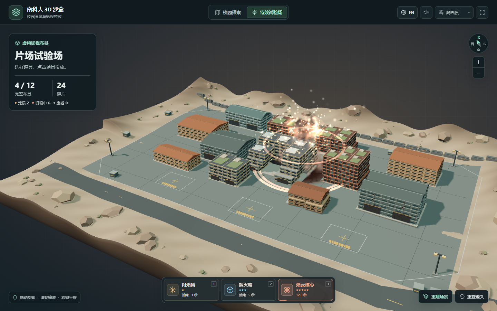

# SUSTech 3D Sandbox

[简体中文](README.zh-CN.md) · [Campus Explorer](https://bruce666-ppp.github.io/SUSTech-3D-Sandbox/) · [Effects Sandbox](https://bruce666-ppp.github.io/SUSTech-3D-Sandbox/#sandbox) · [Data and licenses](DATA-SOURCES.md)

## Campus Explorer

The opening scene is a stylized model of Southern University of Science and Technology in Shenzhen. OpenStreetMap provides the site plan, and Copernicus GLO-30 provides the underlying terrain. It includes 113 mapped building outlines, the road and path network, water, sports grounds and 15 bilingual landmarks. Select a landmark to move the camera closer and view its name, description and available published dimensions.


Selected buildings have recognizable exterior details, including Lynn Library’s triangular skylights and lattice, the Engineering buildings’ courtyards, Yidan Library’s glass frontage and the Humanities precinct’s pitched roofs. Exterior details and many heights are visual approximations. The source notes document the data coverage and terrain grading. [Lynn Library close-up](docs/screenshots/sustech-lynn-library.png) · [Data and model notes](DATA-SOURCES.md)

## Effects Sandbox

The Backlot is a separate fictional film set with its own terrain and 12 modular sets. Open **Effects Sandbox** in the top bar, select a prop, then click or tap the backlot. The prop descends before the flash, dust, shockwaves and staged rigid-body animation begin.

| Key | Prop | Cooldown | Screen effect |
| --- | --- | --- | --- |
| `1` | Flash Canister | 1 s | Amber sparks and localized façade damage |
| `2` | Pyro Crate | 5 s | Cyan flare, square shockwaves and rising smoke |
| `3` | Firecloud Core | 15 s | Layered flashes, warm fire and a dark smoke column |

The scenery shows intact, damaged, collapsing and ruined states. Rubble and ground marks persist as smoke clears. **Rebuild** restores the set and clears active drops and cooldowns. [Backlot overview](docs/screenshots/film-backlot.png) · [Backlot ruins](docs/screenshots/film-backlot-ruins.png)



## Controls

| Input | Action |
| --- | --- |
| Left drag or one finger | Orbit |
| Mouse wheel or pinch | Zoom |
| Right drag or two-finger drag | Pan |
| Landmark button or map pin | Inspect a campus landmark |
| Click or tap the backlot | Drop the selected cinematic prop |

The top bar switches scene, language and graphics quality, toggles sound and opens fullscreen where available. The lower-right controls reset the camera, open a campus overhead view or rebuild the backlot. Preferences are saved locally.

## Run and verify

Use Node.js 22.12 or newer and a WebGL 2 browser. The Pages workflow uses Node.js 24.

```sh
npm ci
npm run dev
```

```sh
npm run build
npm run preview
```

The browser tests serve the production build under `/SUSTech-3D-Sandbox/`. They exercise both scene entry points, the effects sequence and simulated mobile touch. Set `SUSTECH_CHROME_PATH` to run an installed Chrome binary. Set `SUSTECH_SOFTWARE_GL=1` to run the Chromium test with SwiftShader.

```sh
npx playwright install chromium webkit
npm run test:browser
npm run test:browser -- webkit
```

Three.js and OrbitControls are shared. Campus geometry and the backlot’s Rapier world load in distinct chunks. The existing GitHub Actions workflow builds and deploys `dist/` from `main`, with relative URLs for Pages.
