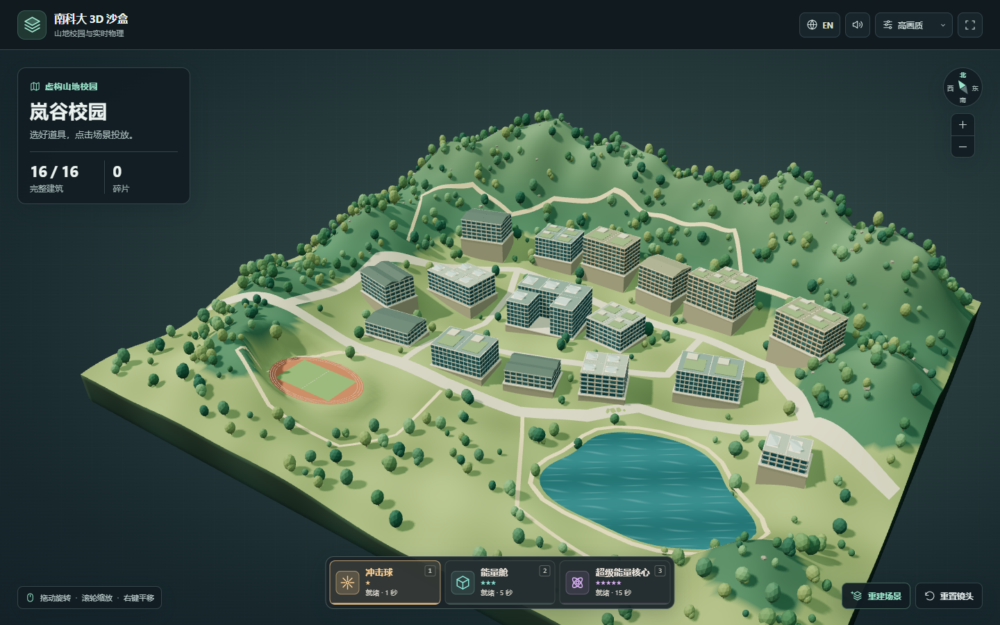

# 南科大 3D 沙盒

[English](README.md) · [GitHub Pages 在线试玩](https://bruce666-ppp.github.io/SUSTech-3D-Sandbox/) · [场景素材与授权](DATA-SOURCES.md)

岚谷校园是一座虚构的山地微缩校园，有环湖步道、跑道、植被和 16 座可分块的建筑。打开网页即可旋转、缩放和平移。使用底部工具栏选择道具，再点击或轻触场景。道具会从空中落向标记位置，接触场景后触发特效。



| 快捷键 | 道具 | 冷却 | 表现 |
| --- | --- | --- | --- |
| `1` | 冲击球 ★ | 1 秒 | 琥珀色圆球翻滚，落地后散出火花和一圈扬尘 |
| `2` | 能量舱 ★★★ | 5 秒 | 青色胶囊分段减速，触地后升起光柱与六边形光波 |
| `3` | 超级能量核心 ★★★★★ | 15 秒 | 紫色核心旋转后快速下落，触发层叠光波与烟尘 |

建筑窗格和屋顶细节会跟随所在模块分离、倾倒和碰撞。粒子消散后，废墟与地表痕迹会保留。点击 **重建场景** 恢复建筑、地面和冷却，并取消正在下落的道具。点击 **重置镜头** 返回初始视角。

| 操作 | 功能 |
| --- | --- |
| 左键拖动或单指拖动 | 旋转 |
| 滚轮或双指捏合 | 缩放 |
| 右键拖动或双指拖动 | 平移 |
| 点击或轻触场景 | 投放选中道具 |

右上角提供简体中文和 English 切换、音效开关、画质和全屏。语言、画质和音效偏好保存在本地。

[能量核心下落](docs/screenshots/mistridge-drop.png) · [建筑模块倾倒](docs/screenshots/mistridge-collapse.png) · [地表痕迹](docs/screenshots/mistridge-terrain.png)

## 本地运行

使用 Node.js 22.12 或更新版本，以及支持 WebGL 2 的浏览器。GitHub Actions 使用 Node.js 24。

```sh
npm ci
npm run dev
```

```sh
npm run build
npm run preview
```

浏览器验收脚本在 `/SUSTech-3D-Sandbox/` 子路径托管生产文件，测试桌面输入和移动触控模拟。可设置 `SUSTECH_CHROME_PATH` 使用已安装的 Chrome，或设置 `SUSTECH_SOFTWARE_GL=1` 使用 Chromium SwiftShader。

```sh
npx playwright install chromium webkit
npm run test:browser
npm run test:browser -- webkit
```

## 技术架构与部署

Vite 构建静态 TypeScript 应用。Three.js 渲染程序生成的山地、植被和实例化建筑。`src/playground.ts` 使用 Rapier 运行固定步长刚体模拟，`src/descent.ts`、`src/effects.ts` 和 `src/audio.ts` 分别管理下落动画、可复用的视觉特效和合成音效。`src/landscape.ts` 使用预设形状制作地表痕迹。画质档位控制分辨率、阴影和特效密度。

现有的 Pages 工作流从 `main` 构建和发布 `dist/`。仓库 **Settings → Pages** 的发布方式为 **GitHub Actions**。Vite 使用相对资源路径，兼容仓库子路径和静态服务器根路径。
