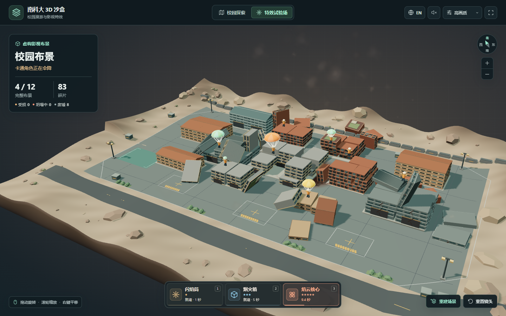

# 南科大 3D 沙盒

[English](README.md) · [校园探索](https://bruce666-ppp.github.io/SUSTech-3D-Sandbox/) · [特效试验场](https://bruce666-ppp.github.io/SUSTech-3D-Sandbox/#sandbox) · [数据来源和授权](DATA-SOURCES.md)

## 校园探索

首页是深圳南方科技大学的风格化三维校园。建筑和道路采用 OpenStreetMap 数据，山体采用 Copernicus GLO-30 高程。场景包含 113 个测绘建筑轮廓、道路、水体、运动场及 15 个双语地标。点选地标可移动镜头，查看介绍及已有公开资料。


重点建筑绘制了琳恩图书馆的三角天窗和格栅、工学院的庭院、一丹图书馆的玻璃幕墙及人文社科学院的坡屋顶。部分外观和楼高采用美术近似，数据覆盖和地表处理见来源说明。 [琳恩图书馆近景](docs/screenshots/sustech-lynn-library.png) · [数据和建模说明](DATA-SOURCES.md)

## 特效试验场

顶部的 **特效试验场** 通往独立的虚构校园布景。这里有操场、绿化带和 12 座可分块建筑。底部选择道具，再点击或轻触布景。三种道具采用游戏强度档位，先播放空中下落，再触发闪光、烟尘、冲击波和刚体动画。

| 快捷键 | 道具 | 冷却 | 画面表现 |
| --- | --- | --- | --- |
| `1` | 闪焰筒 | 1 秒 | 琥珀火花与局部立面受损 |
| `2` | 烟火箱 | 5 秒 | 青色闪光、方形光波与浅色烟柱 |
| `3` | 焰云核心 | 15 秒 | 多段闪光、暖色火团和深色烟柱 |

布景进入废墟状态后，卡通角色会跃出、打开彩色降落伞并落到前方空地。烟尘散去后，废墟、地表痕迹和已着陆角色仍然可见。**重建场景**会恢复布景、地面和冷却，并清除投放道具与伞降角色。 [试验场全景](docs/screenshots/film-backlot.png) · [保留的废墟](docs/screenshots/film-backlot-ruins.png)




## 操作

| 输入 | 功能 |
| --- | --- |
| 左键拖动或单指拖动 | 旋转 |
| 滚轮或双指捏合 | 缩放 |
| 右键拖动或双指拖动 | 平移 |
| 地标列表或地图标记 | 查看校园地点 |
| 点击或轻触试验场 | 投放已选道具 |

顶部可切换场景、语言、画质、音效和全屏。右下角提供重置镜头、俯瞰校园或重建布景。偏好保存在浏览器。

## 运行与验证

使用 Node.js 22.12 或更新版本和支持 WebGL 2 的浏览器。Pages 工作流使用 Node.js 24。

```sh
npm ci
npm run dev
```

```sh
npm run build
npm run preview
```

验收脚本在 `/SUSTech-3D-Sandbox/` 子路径托管生产文件，测试两个入口、完整特效过程和移动触控模拟。可设置 `SUSTECH_CHROME_PATH` 运行已安装的 Chrome，或设置 `SUSTECH_SOFTWARE_GL=1` 运行 Chromium SwiftShader 测试。

```sh
npx playwright install chromium webkit
npm run test:browser
npm run test:browser -- webkit
```

两套场景共享 Three.js 渲染器和 OrbitControls。校园模型和试验场 Rapier 物理世界分别按需加载。现有 GitHub Actions 工作流继续从 `main` 构建并发布 `dist/`，Pages 使用相对资源路径。
